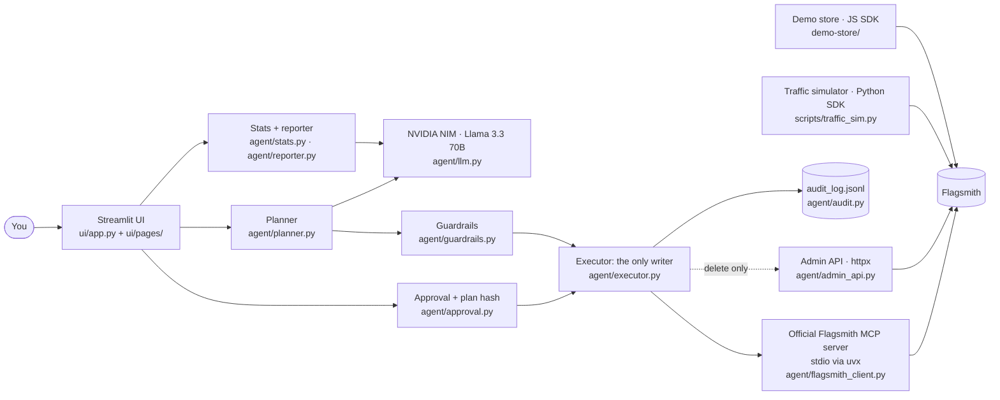

# 🚩 FlagPilot

[](https://github.com/HarshalChugwani2005/flagpilot/actions/workflows/ci.yml)

**Describe an A/B test in plain English. FlagPilot plans it, shows you the exact Flagsmith
changes, and only touches Flagsmith after you approve.**

Flagsmith "Toggle Wars" hackathon · Track 2: AI Agents + Feature Flags

▶️ **Demo video:** VIDEO_URL


## What it does

1. **Plan:** you type a request. Llama 3.3 70B (NVIDIA NIM) returns a validated plan: an
   `fp_` flag, 2–4 variants, a traffic split, the metric event and the risks. It asks
   clarifying questions instead if the request is too vague.
2. **Review:** you see the hypothesis, a live preview of each variant, the split, a numbered
   list of the exact Flagsmith operations, and green/amber/red guardrail checks. Then
   **Approve**, **Edit** (every field, re-validated) or **Reject**.
3. **Apply:** the executor creates the flag through the **official Flagsmith MCP server**,
   logging every call to `audit_log.jsonl`. A dry-run mode logs the calls without sending them.
4. **Measure:** visitors get variants from Flagsmith, and scipy computes conversion, lift,
   95% confidence intervals and a two-proportion z-test. The LLM only narrates those numbers.
5. **Roll out:** a second approval (you type the flag name) sends 100% to the winner and
   records the losing variants as stale.

## Architecture



## How Flagsmith is used

| What | How | Where |
| --- | --- | --- |
| Read flags, project, organisations | MCP tools `list_project_features`, `get_project`, `list_organizations`, `list_projects_in_organization` | [agent/flagsmith_client.py](agent/flagsmith_client.py) |
| Create the experiment flag | MCP `create_feature`: multivariate, control as the base value, variants with percentage allocations, created switched off | [agent/changes.py](agent/changes.py), [agent/executor.py](agent/executor.py) |
| Roll out the winner | MCP `list_project_environments`, `list_project_features`, `list_feature_multivariate_options`, `update_environment_feature_state` | [agent/rollout.py](agent/rollout.py), [agent/executor.py](agent/executor.py) |
| Delete demo flags | Admin API `DELETE /api/v1/projects/{id}/features/{id}/` (the MCP server has no delete tool) | [agent/admin_api.py](agent/admin_api.py), [scripts/reset_demo.py](scripts/reset_demo.py) |
| Assign visitors + send `purchase` events | Python SDK `get_experiment_flag`, `track_event` | [scripts/traffic_sim.py](scripts/traffic_sim.py) |
| Style the store's button per visitor | JS SDK `flagsmith@10.0.0`: `init({identity})`, `getValue` | [demo-store/app.js](demo-store/app.js) |

## Setup (fresh clone)

**You need:** Python 3.11, [uv](https://docs.astral.sh/uv/) (to start the official MCP
server with `uvx`), Node.js 20+ (demo-store tests only) and GNU Make
(on Windows: `winget install ezwinports.make`).

1. **Free NVIDIA API key:** sign in at <https://build.nvidia.com>, open
   `meta/llama-3.3-70b-instruct` and generate an API key (it starts `nvapi-`).
2. **Free Flagsmith account:** sign up at <https://app.flagsmith.com> and create a project
   with a Development environment. Collect:
   - an **Organisation API key** (Organisation Settings → API Keys) → `FLAGSMITH_ADMIN_API_KEY`;
   - the **project id**, the number in the URL `/project/<id>/…` → `FLAGSMITH_PROJECT_ID`;
   - the Development **client-side SDK key** (Environment → SDK Keys) → `FLAGSMITH_ENVIRONMENT_KEY`.
3. **Install and configure:**
   ```bash
   git clone https://github.com/HarshalChugwani2005/flagpilot.git && cd flagpilot
   make install
   cp .env.example .env        # fill in the keys above (see the comments in the file)
   ```
4. **Check both connections** (use `.venv/bin/python` on macOS/Linux):
   ```bash
   .venv/Scripts/python -m agent.llm --smoke              # prints the model name and a reply
   .venv/Scripts/python -m agent.flagsmith_client --smoke  # lists your projects (the first start can take a minute)
   ```
5. **Run:** `make run-ui` → <http://localhost:8501>

| Command | What it does |
| --- | --- |
| `make run-ui` | The FlagPilot app |
| `make seed` | Plans, approves (you type the flag name) and creates `fp_pricing_cta`, then simulates 1,500 visitors |
| `make sim ARGS="--rates control=0.08,variant=0.115"` | Simulates 500 visitors (`--visitors` up to 2000; about 1 API request each) |
| `make run-store` | Demo store on <http://localhost:8000> for the latest live experiment (or `STORE_FLAG_NAME`) |
| `make reset` | Deletes the project's `fp_` flags, backs up and clears the audit log, clears the LLM cache; shows every change and asks you to type the project name first |
| `make test` / `make test-integration` | Unit tests (mocks) / the real plan → create → read back → delete flow (skipped without keys) |

Free tiers: Flagsmith allows 50K API requests a month, so simulations default to 500 visitors.
NVIDIA NIM allows about 40 requests a minute; FlagPilot retries 429s with backoff and caches
replies when `LLM_CACHE=1`.

## Time saved (measured)

FlagPilot records its own time for each live experiment in the audit log: planning (from
**Plan experiment** to the plan appearing) plus applying (from **Approve** to the last
Flagsmith call). Your reading time is measured separately and **not** counted. The manual
baseline is me creating the same experiment by hand in the Flagsmith dashboard.

| | Time | Clicks |
| --- | --- | --- |
| By hand in the Flagsmith dashboard | MANUAL_TIME | MANUAL_CLICKS |
| FlagPilot (planning + applying) | FLAGPILOT_TIME | — |
| My review of the plan (excluded) | REVIEW_TIME | — |

The sidebar's **Time saved** metric shows the same comparison live
(`MANUAL_BASELINE_MINUTES` in `.env`).

## Safety

- **Human approval before every write.** An approval records who approved it, when, and the
  SHA-256 hash of the plan. The executor re-hashes the plan and refuses if anything changed
  after approval, or if the approval isn't in the audit log.
- **One write path.** Only [agent/executor.py](agent/executor.py) changes Flagsmith, and
  every call and result is appended to `audit_log.jsonl`, with keys masked.
- **Guardrails in code** ([agent/guardrails.py](agent/guardrails.py)): development only
  unless `ALLOW_PRODUCTION=1`; at most 50% traffic on a flag's first run; experiment plans
  never delete anything; every flag FlagPilot creates starts with `fp_`.
- **Second approval for rollouts:** you type the flag name. The demo reset needs the project
  name and only touches `fp_` flags.
- **Dry run:** a toggle, or `DRY_RUN=1`, logs the exact calls without sending them.
- **The LLM never computes numbers.** Statistics come from scipy
  ([agent/stats.py](agent/stats.py)); the reporter only receives the rounded results.
- **Secrets live only in `.env`** (gitignored). The demo store's `config.js` is generated
  from `.env` when served, never stored in a file.

## Known limitations

- **Results don't come from Flagsmith yet.** FlagPilot doesn't create Flagsmith
  experiments or metrics, and Flagsmith's API spec doesn't define the metric `definition`
  or the shape of the results response, so the Results page reports "not connected".
  The rollout code is tested with mocks but not yet against live Flagsmith.
- The simulator's `purchase` events are sent, but with no running Flagsmith experiment,
  Flagsmith records no exposures.
- The demo store's button shows each visitor's variant but doesn't send purchase events;
  only the simulator does.
- Visitors outside the experiment's traffic share see the control value.
- Environments with v2 feature versioning: the rollout refuses and changes nothing.
- The official MCP server is installed from Flagsmith's GitHub `main` branch, which isn't
  pinned.
- The Edit dialog can't add or remove variants. Changes to `.env` need an app restart.
- With `LLM_CACHE=1`, a reply that failed validation stays cached; delete `.llm_cache/`
  to retry it fresh.

## Tech

Python 3.11 · Streamlit · Plotly · Pydantic v2 · openai SDK → NVIDIA NIM
(`meta/llama-3.3-70b-instruct`) · official Flagsmith MCP server (MCP Python SDK, stdio) ·
httpx · Flagsmith Python and JS SDKs · scipy · pytest · ruff · GitHub Actions.

## License

[MIT](LICENSE)
